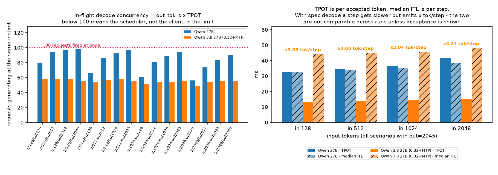

# vLLM serving benchmarks — GPT-OSS 120B vs Qwen 27B (two generations) vs Gemma

Throughput and latency for four model/engine combinations served on a single
GPU, swept across prompt/response length combinations. For the three August 2026
runs the short version was that **there is no single winner**: the leader flipped
depending on the input/output ratio of your traffic. The 2026-11 Qwen run does
win every scenario — but it changed three things at once, so read the warning
under the TL;DR before quoting it.

Every table and figure in this file is **generated** from `results/**` by
`analysis/report.py`. Numbers live between `<!-- BEGIN GENERATED:* -->` markers;
hand-editing them is a CI failure (`make check`).

---

## TL;DR

<!-- BEGIN GENERATED:tldr -->
- **Wins on total token throughput (16 scenarios):** **Qwen 3.8 27B (0.32+MTP)** 16/16. 0/16 scenarios are decided by under 5% — treat those as ties.
- **The runs did not use the same hardware** (Qwen 3.8 27B (0.32+MTP) 2 GPU(s); others used 1) — compare **Avg tok/s / GPU**, not Avg tok/s.
- **Peak total throughput:** **18,051 tok/s** by Qwen 3.8 27B (0.32+MTP) at in2048/out128 — prefill-heavy, since input tokens dominate this metric.
- **Peak decode throughput:** **4,171 output tok/s** by Qwen 3.8 27B (0.32+MTP) at in128/out2045 — the only metric that isolates generation speed.
- **One run wins every scenario** — read that as a *stack* result, not a model result: see the caveat under this list and the Data gaps section for what else changed.
<!-- END GENERATED:tldr -->

> ⚠️ **The 2026-11 run is not a clean model comparison — it used two GPUs.**
> `Qwen 3.8 27B (0.32+MTP)` differs from `Qwen 27B` in **four things at once**:
> **GPU count (1 → 2, `--data-parallel-size 2`)**, checkpoint (3.6 → 3.8), engine
> (vLLM 0.2x → 0.32.0), and **speculative decoding, which is now on** (MTP, 3 draft
> tokens, acceptance length 2.17–3.21). Read the two numbers separately: **as
> deployed the service is ~50 % faster and TTFT roughly halves; per GPU it is
> ~27 % slower** (see the *Avg tok/s / GPU* column below). The aggregate prefill
> gain (~1.9×) is about what DP=2 alone predicts, and **the entire decode gain is
> speculative decoding** — median ITL per step *rose* 25–43 % while TPOT per
> accepted token *fell* 41–64 %. Full write-up:
> [docs/runs/2026-11.md](docs/runs/2026-11.md).

---

## Which model for which workload

<!-- BEGIN GENERATED:recommend -->
| Workload shape | Pick | Measured per scenario (delta vs the scenario leader) |
|---|:---|---|
| Long prompt, short answer (RAG, extract, classify) | **Qwen 3.8 27B (0.32+MTP)** | in1024/out128: 14,988 tok/s (+20%); in2048/out128: 18,051 tok/s (+17%) |
| Short prompt, long answer (generation, agents, code) | **Qwen 3.8 27B (0.32+MTP)** | in128/out1024: 4,110 output tok/s (+31%); in128/out2045: 4,171 output tok/s (+38%) |
| Balanced prompt/response (in == out) | **Qwen 3.8 27B (0.32+MTP)** | in128/out128: 6,442 tok/s (+23%); in512/out512: 6,801 tok/s (+34%); in1024/out1024: 6,713 tok/s (+25%) |
| Maximum requests/sec (small chatty traffic) | **Qwen 3.8 27B (0.32+MTP)** | in128/out128: 25.16 req/s (+23%); in512/out128: 17.42 req/s (+40%) |
<!-- END GENERATED:recommend -->

---

## Summary statistics

<!-- BEGIN GENERATED:summary -->
| Model | Avg tok/s | Avg tok/s / GPU | Avg req/s | Peak tok/s | Peak req/s | Avg out tok/s | Scenarios won | Runs / scenario |
|---|---|---|---|---|---|---|---|---|
| **Qwen 3.8 27B (0.32+MTP)** | 8,329 | 4,164 | 6.92 | 18,051 | 25.16 | 3,189 | 16 / 16 | 1 |
| **GPT-OSS 120B** | 6,093 | 6,093 | 4.60 | 15,372 | 11.79 | 2,229 | 0 / 16 | 1 |
| **Qwen 27B** | 5,545 | 5,545 | 4.94 | 10,488 | 20.53 | 2,240 | 0 / 16 | 1 |
| **Gemma** | 2,424 | 2,424 | 2.31 | 3,571 | 10.92 | 1,062 | 0 / 16 | 1 |
<!-- END GENERATED:summary -->

---

## Figures

| | |
|---|---|
|  | **Total token throughput.** Note how the GPT-OSS panel lights up along the *input* axis — that is prefill, not generation. |
|  | **Best non-baseline speedup** per scenario. The top-left corner is where the ranking inverts. |
|  | **Throughput vs prompt length.** The gap between models widens with prompt size. |
|  | **Requests/sec vs response length** — the metric that matters for chat-shaped traffic. |
|  | **Generated tokens/sec.** The prefill-heavy scenarios that top the total-throughput tables collapse here. |
|  | **Why the 2026-11 run is faster, and what it costs.** Left: in-flight decode concurrency (`out_tok_s × TPOT`) — the new run keeps ~55 sequences in flight where the old one kept ~84. Right: TPOT is per *accepted* token, median ITL is per *step*; with spec decode steps get slower but emit 2.2–3.2 tokens each. |

Regenerate with `make figures` (needs matplotlib, see `pyproject.toml`).

---

## Per-scenario detail

### Total token throughput (tok/s)

<!-- BEGIN GENERATED:heatmaps -->
**Gemma** — total tok/s

| In \ Out | 128 | 512 | 1024 | 2045 |
|---|---|---|---|---|
| **128** | 2,796 | 2,358 | 1,903 | 1,618 |
| **512** | 3,499 | 2,383 | 1,948 | 1,644 |
| **1024** | 3,514 | 2,561 | 2,103 | 1,744 |
| **2048** | 3,571 | 2,850 | 2,374 | 1,921 |

**GPT-OSS 120B** — total tok/s

| In \ Out | 128 | 512 | 1024 | 2045 |
|---|---|---|---|---|
| **128** | 2,701 | 2,987 | 3,110 | 3,096 |
| **512** | 7,547 | 4,937 | 4,104 | 3,647 |
| **1024** | 12,468 | 7,076 | 5,349 | 4,282 |
| **2048** | 15,372 | 9,391 | 6,910 | 4,511 |

**Qwen 27B** — total tok/s

| In \ Out | 128 | 512 | 1024 | 2045 |
|---|---|---|---|---|
| **128** | 5,256 | 3,889 | 3,524 | 3,211 |
| **512** | 7,962 | 5,093 | 4,144 | 3,492 |
| **1024** | 9,361 | 6,238 | 4,834 | 3,839 |
| **2048** | 10,488 | 7,371 | 5,694 | 4,329 |

**Qwen 3.8 27B (0.32+MTP)** — total tok/s

| In \ Out | 128 | 512 | 1024 | 2045 |
|---|---|---|---|---|
| **128** | 6,442 | 4,784 | 4,623 | 4,432 |
| **512** | 11,150 | 6,801 | 5,616 | 4,989 |
| **1024** | 14,988 | 8,972 | 6,713 | 5,698 |
| **2048** | 18,051 | 13,159 | 9,568 | 7,275 |
<!-- END GENERATED:heatmaps -->

### Head-to-head — total token throughput (tok/s)

<!-- BEGIN GENERATED:head2head-tok -->
| Scenario | Gemma | GPT-OSS 120B | Qwen 27B | Qwen 3.8 27B (0.32+MTP) | Leader |
|---|---|---|---|---|---|
| in128/out128 | 2,796 | 2,701 | 5,256 | 6,442 | Qwen 3.8 27B (0.32+MTP) |
| in128/out512 | 2,358 | 2,987 | 3,889 | 4,784 | Qwen 3.8 27B (0.32+MTP) |
| in128/out1024 | 1,903 | 3,110 | 3,524 | 4,623 | Qwen 3.8 27B (0.32+MTP) |
| in128/out2045 | 1,618 | 3,096 | 3,211 | 4,432 | Qwen 3.8 27B (0.32+MTP) |
| in512/out128 | 3,499 | 7,547 | 7,962 | 11,150 | Qwen 3.8 27B (0.32+MTP) |
| in512/out512 | 2,383 | 4,937 | 5,093 | 6,801 | Qwen 3.8 27B (0.32+MTP) |
| in512/out1024 | 1,948 | 4,104 | 4,144 | 5,616 | Qwen 3.8 27B (0.32+MTP) |
| in512/out2045 | 1,644 | 3,647 | 3,492 | 4,989 | Qwen 3.8 27B (0.32+MTP) |
| in1024/out128 | 3,514 | 12,468 | 9,361 | 14,988 | Qwen 3.8 27B (0.32+MTP) |
| in1024/out512 | 2,561 | 7,076 | 6,238 | 8,972 | Qwen 3.8 27B (0.32+MTP) |
| in1024/out1024 | 2,103 | 5,349 | 4,834 | 6,713 | Qwen 3.8 27B (0.32+MTP) |
| in1024/out2045 | 1,744 | 4,282 | 3,839 | 5,698 | Qwen 3.8 27B (0.32+MTP) |
| in2048/out128 | 3,571 | 15,372 | 10,488 | 18,051 | Qwen 3.8 27B (0.32+MTP) |
| in2048/out512 | 2,850 | 9,391 | 7,371 | 13,159 | Qwen 3.8 27B (0.32+MTP) |
| in2048/out1024 | 2,374 | 6,910 | 5,694 | 9,568 | Qwen 3.8 27B (0.32+MTP) |
| in2048/out2045 | 1,921 | 4,511 | 4,329 | 7,275 | Qwen 3.8 27B (0.32+MTP) |
<!-- END GENERATED:head2head-tok -->

### Head-to-head — decode throughput (output tok/s)

The ranking is identical to the table above — `out_tok_s` is `total_tok_s` scaled
by the per-scenario constant `out/(in+out)` — but the magnitudes are what you
budget GPU capacity against, and they are an order of magnitude smaller.

<!-- BEGIN GENERATED:head2head-decode -->
| Scenario | Gemma | GPT-OSS 120B | Qwen 27B | Qwen 3.8 27B (0.32+MTP) | Leader |
|---|---|---|---|---|---|
| in128/out128 | 1,398 | 1,351 | 2,628 | 3,221 | Qwen 3.8 27B (0.32+MTP) |
| in128/out512 | 1,887 | 2,390 | 3,111 | 3,828 | Qwen 3.8 27B (0.32+MTP) |
| in128/out1024 | 1,691 | 2,765 | 3,132 | 4,110 | Qwen 3.8 27B (0.32+MTP) |
| in128/out2045 | 1,523 | 2,914 | 3,022 | 4,171 | Qwen 3.8 27B (0.32+MTP) |
| in512/out128 | 700 | 1,509 | 1,592 | 2,230 | Qwen 3.8 27B (0.32+MTP) |
| in512/out512 | 1,192 | 2,468 | 2,547 | 3,400 | Qwen 3.8 27B (0.32+MTP) |
| in512/out1024 | 1,298 | 2,736 | 2,762 | 3,744 | Qwen 3.8 27B (0.32+MTP) |
| in512/out2045 | 1,315 | 2,916 | 2,793 | 3,990 | Qwen 3.8 27B (0.32+MTP) |
| in1024/out128 | 390 | 1,385 | 1,040 | 1,665 | Qwen 3.8 27B (0.32+MTP) |
| in1024/out512 | 854 | 2,359 | 2,079 | 2,991 | Qwen 3.8 27B (0.32+MTP) |
| in1024/out1024 | 1,052 | 2,675 | 2,417 | 3,356 | Qwen 3.8 27B (0.32+MTP) |
| in1024/out2045 | 1,162 | 2,853 | 2,558 | 3,797 | Qwen 3.8 27B (0.32+MTP) |
| in2048/out128 | 210 | 904 | 617 | 1,062 | Qwen 3.8 27B (0.32+MTP) |
| in2048/out512 | 570 | 1,878 | 1,474 | 2,632 | Qwen 3.8 27B (0.32+MTP) |
| in2048/out1024 | 791 | 2,303 | 1,898 | 3,189 | Qwen 3.8 27B (0.32+MTP) |
| in2048/out2045 | 960 | 2,254 | 2,163 | 3,635 | Qwen 3.8 27B (0.32+MTP) |
<!-- END GENERATED:head2head-decode -->

### Head-to-head — request throughput (req/s)

<!-- BEGIN GENERATED:head2head-req -->
| Scenario | Gemma | GPT-OSS 120B | Qwen 27B | Qwen 3.8 27B (0.32+MTP) | Leader |
|---|---|---|---|---|---|
| in128/out128 | 10.92 | 10.55 | 20.53 | 25.16 | Qwen 3.8 27B (0.32+MTP) |
| in128/out512 | 3.68 | 4.67 | 6.08 | 7.48 | Qwen 3.8 27B (0.32+MTP) |
| in128/out1024 | 1.65 | 2.70 | 3.06 | 4.01 | Qwen 3.8 27B (0.32+MTP) |
| in128/out2045 | 0.74 | 1.42 | 1.48 | 2.04 | Qwen 3.8 27B (0.32+MTP) |
| in512/out128 | 5.47 | 11.79 | 12.44 | 17.42 | Qwen 3.8 27B (0.32+MTP) |
| in512/out512 | 2.33 | 4.82 | 4.97 | 6.64 | Qwen 3.8 27B (0.32+MTP) |
| in512/out1024 | 1.27 | 2.67 | 2.70 | 3.66 | Qwen 3.8 27B (0.32+MTP) |
| in512/out2045 | 0.64 | 1.43 | 1.37 | 1.95 | Qwen 3.8 27B (0.32+MTP) |
| in1024/out128 | 3.05 | 10.82 | 8.13 | 13.01 | Qwen 3.8 27B (0.32+MTP) |
| in1024/out512 | 1.67 | 4.61 | 4.06 | 5.84 | Qwen 3.8 27B (0.32+MTP) |
| in1024/out1024 | 1.03 | 2.61 | 2.36 | 3.28 | Qwen 3.8 27B (0.32+MTP) |
| in1024/out2045 | 0.57 | 1.40 | 1.25 | 1.86 | Qwen 3.8 27B (0.32+MTP) |
| in2048/out128 | 1.64 | 7.06 | 4.82 | 8.30 | Qwen 3.8 27B (0.32+MTP) |
| in2048/out512 | 1.11 | 3.67 | 2.88 | 5.14 | Qwen 3.8 27B (0.32+MTP) |
| in2048/out1024 | 0.77 | 2.25 | 1.85 | 3.11 | Qwen 3.8 27B (0.32+MTP) |
| in2048/out2045 | 0.47 | 1.10 | 1.06 | 1.78 | Qwen 3.8 27B (0.32+MTP) |
<!-- END GENERATED:head2head-req -->

### Speedup vs baseline

<!-- BEGIN GENERATED:speedup -->
Baseline for every ratio is **Gemma** (slowest average total throughput). Values above 1.00x mean the model beat the baseline on total tokens/sec.

| Scenario | GPT-OSS 120B / Gemma | Qwen 27B / Gemma | Qwen 3.8 27B (0.32+MTP) / Gemma |
|---|---|---|---|
| in128/out128 | 0.97x | 1.88x | 2.30x |
| in128/out512 | 1.27x | 1.65x | 2.03x |
| in128/out1024 | 1.63x | 1.85x | 2.43x |
| in128/out2045 | 1.91x | 1.98x | 2.74x |
| in512/out128 | 2.16x | 2.28x | 3.19x |
| in512/out512 | 2.07x | 2.14x | 2.85x |
| in512/out1024 | 2.11x | 2.13x | 2.88x |
| in512/out2045 | 2.22x | 2.12x | 3.03x |
| in1024/out128 | 3.55x | 2.66x | 4.26x |
| in1024/out512 | 2.76x | 2.44x | 3.50x |
| in1024/out1024 | 2.54x | 2.30x | 3.19x |
| in1024/out2045 | 2.46x | 2.20x | 3.27x |
| in2048/out128 | 4.31x | 2.94x | 5.06x |
| in2048/out512 | 3.30x | 2.59x | 4.62x |
| in2048/out1024 | 2.91x | 2.40x | 4.03x |
| in2048/out2045 | 2.35x | 2.25x | 3.79x |
<!-- END GENERATED:speedup -->

### Latency

<!-- BEGIN GENERATED:latency -->
**Qwen 27B** — latency in ms (mean, and p99 where noted)

| Scenario | TTFT mean | TTFT p99 | TPOT mean | TPOT p99 | ITL p99 |
|---|---|---|---|---|---|
| in128/out128 | 986 | 1,161 | 30.4 | 32.9 | 31.9 |
| in128/out512 | 1,011 | 1,158 | 30.2 | 31.2 | 31.2 |
| in128/out1024 | 1,035 | 1,183 | 30.9 | 31.5 | 32.8 |
| in128/out2045 | 1,005 | 1,176 | 32.6 | 32.8 | 35.7 |
| in512/out128 | 2,720 | 4,238 | 41.3 | 58.3 | 660.2 |
| in512/out512 | 2,716 | 4,230 | 33.9 | 37.8 | 32.5 |
| in512/out1024 | 2,715 | 4,191 | 33.5 | 35.6 | 34.2 |
| in512/out2045 | 2,712 | 4,229 | 34.5 | 35.3 | 37.0 |
| in1024/out128 | 4,811 | 8,339 | 58.0 | 86.7 | 665.8 |
| in1024/out512 | 4,741 | 8,199 | 38.7 | 45.7 | 508.8 |
| in1024/out1024 | 4,718 | 8,170 | 36.7 | 40.5 | 35.6 |
| in1024/out2045 | 4,723 | 8,216 | 36.7 | 38.5 | 38.4 |
| in2048/out128 | 8,943 | 16,537 | 90.9 | 153.5 | 671.6 |
| in2048/out512 | 8,960 | 16,598 | 49.9 | 64.6 | 666.3 |
| in2048/out1024 | 8,929 | 16,545 | 43.8 | 51.1 | 644.0 |
| in2048/out2045 | 8,942 | 16,529 | 41.7 | 45.4 | 42.0 |

**Qwen 3.8 27B (0.32+MTP)** — latency in ms (mean, and p99 where noted)

| Scenario | TTFT mean | TTFT p99 | TPOT mean | TPOT p99 | ITL p99 |
|---|---|---|---|---|---|
| in128/out128 | 587 | 701 | 17.8 | 25.8 | 53.1 |
| in128/out512 | 529 | 664 | 15.2 | 24.9 | 45.0 |
| in128/out1024 | 600 | 724 | 14.0 | 23.7 | 44.9 |
| in128/out2045 | 590 | 700 | 13.4 | 20.5 | 46.8 |
| in512/out128 | 1,511 | 2,409 | 24.0 | 37.5 | 642.3 |
| in512/out512 | 1,396 | 2,209 | 16.7 | 26.0 | 52.2 |
| in512/out1024 | 1,392 | 2,238 | 15.4 | 25.4 | 45.7 |
| in512/out2045 | 1,394 | 2,229 | 13.9 | 24.0 | 47.8 |
| in1024/out128 | 2,467 | 4,334 | 31.1 | 51.0 | 662.9 |
| in1024/out512 | 2,465 | 4,352 | 17.9 | 30.7 | 618.0 |
| in1024/out1024 | 2,460 | 4,336 | 16.0 | 28.5 | 51.1 |
| in1024/out2045 | 2,489 | 4,374 | 14.4 | 24.6 | 48.7 |
| in2048/out128 | 4,907 | 8,798 | 46.0 | 82.0 | 669.5 |
| in2048/out512 | 3,569 | 6,562 | 20.5 | 33.1 | 665.4 |
| in2048/out1024 | 3,664 | 6,858 | 17.4 | 27.9 | 651.2 |
| in2048/out2045 | 3,750 | 6,837 | 15.2 | 24.9 | 52.0 |
<!-- END GENERATED:latency -->

---

## Reading the numbers honestly

- **`tok/s` counts prompt tokens.** It is `(input + output) tokens / wall-clock`,
  so a scenario with a long prompt and a one-line answer scores highest without
  generating much of anything. That is why the headline peak sits at
  `in2048/out128`. For generation speed use `out_tok_s`; for chat traffic use
  `req_s`.
- **`out_tok_s` is derivable, TTFT/TPOT are not.** `out_tok_s = total_tok_s ×
  out/(in+out)` exactly, so the two legacy runs get decode throughput in
  `analysis/ingest.py` (flagged `out_tok_s_source=derived`). Latency percentiles
  cannot be recovered from a legacy result file — only a re-run gets them.
- **Prefill and decode are different bottlenecks.** Long-input scenarios measure
  how fast a model ingests a prompt; long-output scenarios measure how fast it
  emits tokens. A model can win one and lose the other, and this dataset shows
  exactly that.
- **Short-output TPOT is not a decode measurement.** With only ~128 generated
  tokens, per-token time is dominated by prefill/queueing interference from
  co-queued requests, not by steady-state generation.
- **TTFT is affine in prompt length, not proportional.** For the 2026-08 Qwen
  run the fit is roughly `TTFT ≈ 0.5 s + ~4 ms × input_tokens`; for the 2026-11
  run it is `≈ 0.3–0.55 s + ~1.6–2.2 ms × input_tokens`, i.e. prefill is ~1.9×
  faster. Either way per-token TTFT *falls* as prompts grow. See the latency
  table above.
- **TPOT and ITL change meaning under speculative decoding.** In the 2026-11 run
  `median_ITL / TPOT == spec_accept_len` exactly (2.17–3.21), because one step
  verifies 1 + 3 draft tokens. So its TPOT (13.4–17.4 ms) is per *accepted* token
  while its step time (42–48 ms median) is *worse* than the 2026-08 run's
  (29–38 ms). Never compare TPOT across runs without checking
  `spec_accept_len` — a spec-decode run can win on TPOT while its engine is
  slower per step.
- **`max_output_tokens_per_s` is broken in the 2026-11 files** — near-constant
  2,150–2,350 and *below* the average `output_throughput` in 13 of 16 files. It
  is deliberately not ingested; do not quote it.
- **Acceptance rates from a `random` dataset are optimistic.** 39–74 % acceptance
  here comes from random token prompts under greedy decoding; real chat/code
  traffic accepts less, so the decode gain will shrink in production.
- **Throughput must be normalised per GPU.** The 2026-11 run used
  `--data-parallel-size 2`; every 2026-08 run used one GPU. Aggregate mean
  8,329 tok/s is **4,165 tok/s per GPU** against the old run's 5,545 — i.e. −27 %
  per GPU. The summary table carries an `Avg tok/s / GPU` column; the GPU count
  lives in `results/manifest.json` under `gpus`.
- **Concurrency is part of the result, not a constant.** In-flight decode
  concurrency (`out_tok_s × TPOT`) was ~84 avg (up to 99) on the single 2026-08
  GPU and ~55 aggregate in 2026-11 — about **27 per DP rank**. A 2.4× per-token
  win multiplied by a much smaller resident batch lands at ~1.4× aggregate. The
  earlier guess (`max_num_seqs`) is ruled out — that is 969. The live candidates
  are KV residency (`--kv-cache-dtype fp8` was dropped, so KV bytes per token
  roughly double) and MTP's extra draft slots.
- **These are saturation runs.** 100 requests are fired at once
  (`--request-rate inf`), so the numbers describe throughput at the concurrency
  ceiling, not latency under a target SLO.

Full definitions: [`analysis/schema.md`](analysis/schema.md) and
[`docs/methodology.md`](docs/methodology.md). Known holes in the data:
[`docs/caveats.md`](docs/caveats.md).

---

## Data gaps

<!-- BEGIN GENERATED:gaps -->
- **GPT-OSS 120B**: no TTFT, TPOT — legacy result format, and unlike output throughput these are not derivable
- **GPT-OSS 120B**: `out_tok_s` is **derived** arithmetic (`total_tok_s × out/(in+out)`), not measured by the bench — rankings are unaffected, the absolute value is unverified
- **GPT-OSS 120B**: 1 run per scenario — no variance estimate, gaps under ~5% are noise
- **Qwen 27B**: 1 run per scenario — no variance estimate, gaps under ~5% are noise
- **Gemma**: no TTFT, TPOT — legacy result format, and unlike output throughput these are not derivable
- **Gemma**: `out_tok_s` is **derived** arithmetic (`total_tok_s × out/(in+out)`), not measured by the bench — rankings are unaffected, the absolute value is unverified
- **Gemma**: model variant (size / quantization) never recorded — the run is not reproducible
- **Gemma**: 1 run per scenario — no variance estimate, gaps under ~5% are noise
- **Qwen 3.8 27B (0.32+MTP)**: ran on **2 GPUs** while other runs used 1 — its throughput is not comparable without dividing by GPU count (see the Avg tok/s / GPU column)
- **Qwen 3.8 27B (0.32+MTP)**: 1 run per scenario — no variance estimate, gaps under ~5% are noise
- excluded `results_gpt_oss_120b_gpu0.json`: Different load: 1000 prompts instead of 100, and the file name carries no in/out lengths. Kept in the tree for reference, excluded from all tables.
<!-- END GENERATED:gaps -->

---

## Repo layout

```
bench/            how the numbers are produced
  run.sh          parameterised `vllm bench serve` sweep
  sweep.env       length grid, prompt count, client image
  serve/          per-model server launch configs (compose)
results/          raw bench output — append-only, never edited
  manifest.json   which run is which model, plus exclusions
analysis/         ingest -> normalize -> render -> verify
  ingest.py       raw JSONs -> data/normalized.csv (integrity-checked)
  report.py       data -> README tables + data/leaderboard.json
  figures.py      data -> docs/figures/*.png
  verify.py       audit gate used by CI
  register.py     add a new run to the manifest
  schema.md       canonical column definitions
data/             generated, committed: normalized.csv/.jsonl, leaderboard.json
docs/             methodology, caveats, run log, figures
```

## Common tasks

```bash
make all                       # ingest + report + figures + verify
make check                     # what CI runs: fail if anything is stale

# run a new sweep against a live server, then register it
bench/run.sh --model qwen3.6-27b-fp8 --label "Qwen 27B" \
             --base-url http://localhost:9000 --served-model qwen/qwen3.6-27b
python3 analysis/register.py --dir results/<run_id> --model qwen3.6-27b-fp8 \
             --label "Qwen 27B" --notes "what changed vs last run"
make ingest report verify
```

## Rules for adding data

1. **Never edit or rename a raw result file.** Drop it in a new
   `results/<date>_<model>_<tag>/` directory and register it.
2. **Model identity goes in `results/manifest.json`**, not in the file name —
   the August Gemma run is named `results_gpt_oss_120b_*.json` and that is why
   the pipeline reads the manifest, not the name.
3. **Record the server config** in `bench/serve/<model>.yml` and the environment
   capture (`_env.txt`) that `bench/run.sh` writes. Two of the three runs in this
   repo have no recorded server flags; do not add a third.
4. **Run at least 3 repeats** for anything you intend to defend in a meeting.
   Everything currently here is n=1.
5. **Record the hardware**: how many GPUs the server used, in `gpus` in
   `results/manifest.json`. Throughput across runs with different GPU counts is
   meaningless until it is divided by GPU count — the summary table does this
   automatically.
6. **Record what actually changed**: vLLM image tag, serve flags, and whether
   speculative decoding was on. `analysis/ingest.py` captures
   `spec_accept_len` / `spec_accept_rate` when the bench reports them, but the
   engine version and the draft method only live in the manifest — a run without
   them cannot be attributed to the model, the engine or the sampler.
