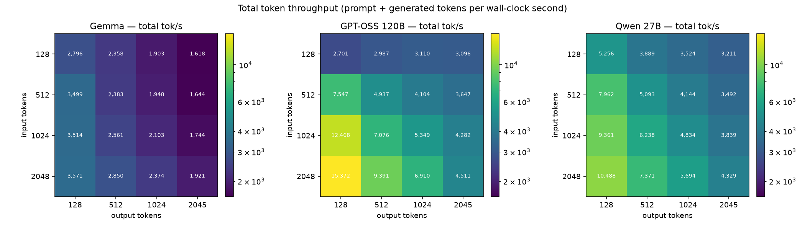
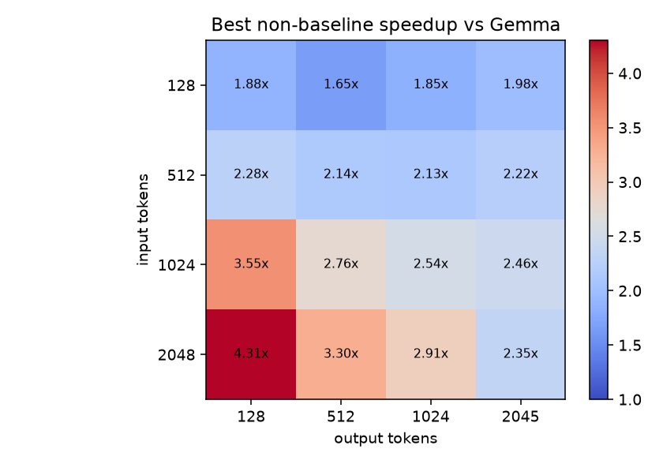
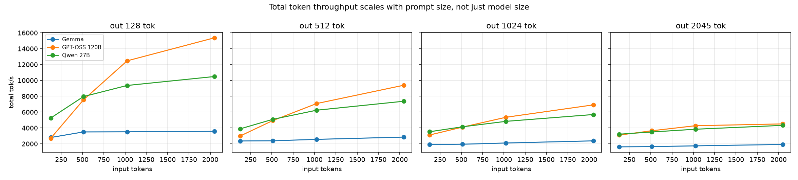
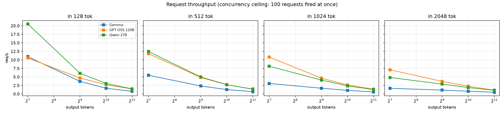
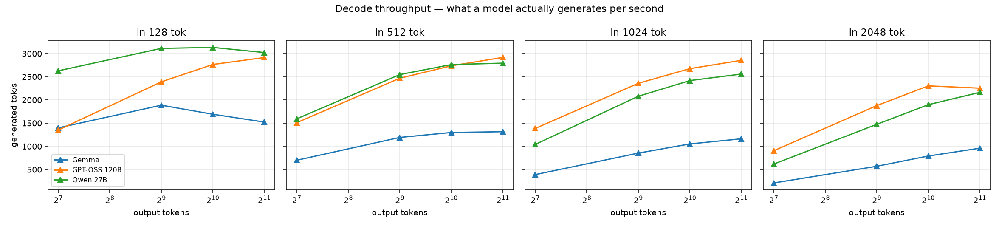

# vLLM serving benchmarks — GPT-OSS 120B vs Qwen 27B vs Gemma

Throughput and latency for three models served on a single GPU, swept across
prompt/response length combinations. The short version is that **there is no
single winner**: the leader flips depending on the input/output ratio of your
traffic.

Every table and figure in this file is **generated** from `results/**` by
`analysis/report.py`. Numbers live between `<!-- BEGIN GENERATED:* -->` markers;
hand-editing them is a CI failure (`make check`).

---

## TL;DR

<!-- BEGIN GENERATED:tldr -->
- **Wins on total token throughput (16 scenarios):** **GPT-OSS 120B** 9/16, **Qwen 27B** 7/16. 5/16 scenarios are decided by under 5% — treat those as ties.
- **Peak total throughput:** **15,372 tok/s** by GPT-OSS 120B at in2048/out128 — prefill-heavy, since input tokens dominate this metric.
- **Peak decode throughput:** **3,132 output tok/s** by Qwen 27B at in128/out1024 — the only metric that isolates generation speed.
- **The leader flips with the input/output ratio**, so pick per workload (table below) rather than per model name.
<!-- END GENERATED:tldr -->

---

## Which model for which workload

<!-- BEGIN GENERATED:recommend -->
| Workload shape | Pick | Measured per scenario (delta vs the scenario leader) |
|---|:---|---|
| Long prompt, short answer (RAG, extract, classify) | **GPT-OSS 120B** | in1024/out128: 12,468 tok/s (+33%); in2048/out128: 15,372 tok/s (+47%) |
| Short prompt, long answer (generation, agents, code) | **Qwen 27B** | in128/out1024: 3,132 output tok/s (+13%); in128/out2045: 3,022 output tok/s (+4%) |
| Balanced prompt/response (in == out) | **Qwen 27B** _(wins 2/3 scenarios)_ | in128/out128: 5,256 tok/s (+88%); in512/out512: 5,093 tok/s (+3%); in1024/out1024: 4,834 tok/s (−10% vs GPT-OSS 120B) |
| Maximum requests/sec (small chatty traffic) | **Qwen 27B** | in128/out128: 20.53 req/s (+88%); in512/out128: 12.44 req/s (+5%) |
<!-- END GENERATED:recommend -->

---

## Summary statistics

<!-- BEGIN GENERATED:summary -->
| Model | Avg tok/s | Avg req/s | Peak tok/s | Peak req/s | Avg out tok/s | Scenarios won | Runs / scenario |
|---|---|---|---|---|---|---|---|
| **GPT-OSS 120B** | 6,093 | 4.60 | 15,372 | 11.79 | 2,229 | 9 / 16 | 1 |
| **Qwen 27B** | 5,545 | 4.94 | 10,488 | 20.53 | 2,240 | 7 / 16 | 1 |
| **Gemma** | 2,424 | 2.31 | 3,571 | 10.92 | 1,062 | 0 / 16 | 1 |
<!-- END GENERATED:summary -->

---

## Figures

| | |
|---|---|
|  | **Total token throughput.** Note how the GPT-OSS panel lights up along the *input* axis — that is prefill, not generation. |
|  | **Best non-baseline speedup** per scenario. The top-left corner is where the ranking inverts. |
|  | **Throughput vs prompt length.** The gap between models widens with prompt size. |
|  | **Requests/sec vs response length** — the metric that matters for chat-shaped traffic. |
|  | **Generated tokens/sec.** The prefill-heavy scenarios that top the total-throughput tables collapse here. |

Regenerate with `make figures` (needs matplotlib, see `pyproject.toml`).

---

## Per-scenario detail

### Total token throughput (tok/s)

<!-- BEGIN GENERATED:heatmaps -->
**Gemma** — total tok/s

| In \ Out | 128 | 512 | 1024 | 2045 |
|---|---|---|---|---|
| **128** | 2,796 | 2,358 | 1,903 | 1,618 |
| **512** | 3,499 | 2,383 | 1,948 | 1,644 |
| **1024** | 3,514 | 2,561 | 2,103 | 1,744 |
| **2048** | 3,571 | 2,850 | 2,374 | 1,921 |

**GPT-OSS 120B** — total tok/s

| In \ Out | 128 | 512 | 1024 | 2045 |
|---|---|---|---|---|
| **128** | 2,701 | 2,987 | 3,110 | 3,096 |
| **512** | 7,547 | 4,937 | 4,104 | 3,647 |
| **1024** | 12,468 | 7,076 | 5,349 | 4,282 |
| **2048** | 15,372 | 9,391 | 6,910 | 4,511 |

**Qwen 27B** — total tok/s

| In \ Out | 128 | 512 | 1024 | 2045 |
|---|---|---|---|---|
| **128** | 5,256 | 3,889 | 3,524 | 3,211 |
| **512** | 7,962 | 5,093 | 4,144 | 3,492 |
| **1024** | 9,361 | 6,238 | 4,834 | 3,839 |
| **2048** | 10,488 | 7,371 | 5,694 | 4,329 |
<!-- END GENERATED:heatmaps -->

### Head-to-head — total token throughput (tok/s)

<!-- BEGIN GENERATED:head2head-tok -->
| Scenario | Gemma | GPT-OSS 120B | Qwen 27B | Leader |
|---|---|---|---|---|
| in128/out128 | 2,796 | 2,701 | 5,256 | Qwen 27B |
| in128/out512 | 2,358 | 2,987 | 3,889 | Qwen 27B |
| in128/out1024 | 1,903 | 3,110 | 3,524 | Qwen 27B |
| in128/out2045 | 1,618 | 3,096 | 3,211 | Qwen 27B |
| in512/out128 | 3,499 | 7,547 | 7,962 | Qwen 27B |
| in512/out512 | 2,383 | 4,937 | 5,093 | Qwen 27B |
| in512/out1024 | 1,948 | 4,104 | 4,144 | Qwen 27B |
| in512/out2045 | 1,644 | 3,647 | 3,492 | GPT-OSS 120B |
| in1024/out128 | 3,514 | 12,468 | 9,361 | GPT-OSS 120B |
| in1024/out512 | 2,561 | 7,076 | 6,238 | GPT-OSS 120B |
| in1024/out1024 | 2,103 | 5,349 | 4,834 | GPT-OSS 120B |
| in1024/out2045 | 1,744 | 4,282 | 3,839 | GPT-OSS 120B |
| in2048/out128 | 3,571 | 15,372 | 10,488 | GPT-OSS 120B |
| in2048/out512 | 2,850 | 9,391 | 7,371 | GPT-OSS 120B |
| in2048/out1024 | 2,374 | 6,910 | 5,694 | GPT-OSS 120B |
| in2048/out2045 | 1,921 | 4,511 | 4,329 | GPT-OSS 120B |
<!-- END GENERATED:head2head-tok -->

### Head-to-head — decode throughput (output tok/s)

The ranking is identical to the table above — `out_tok_s` is `total_tok_s` scaled
by the per-scenario constant `out/(in+out)` — but the magnitudes are what you
budget GPU capacity against, and they are an order of magnitude smaller.

<!-- BEGIN GENERATED:head2head-decode -->
| Scenario | Gemma | GPT-OSS 120B | Qwen 27B | Leader |
|---|---|---|---|---|
| in128/out128 | 1,398 | 1,351 | 2,628 | Qwen 27B |
| in128/out512 | 1,887 | 2,390 | 3,111 | Qwen 27B |
| in128/out1024 | 1,691 | 2,765 | 3,132 | Qwen 27B |
| in128/out2045 | 1,523 | 2,914 | 3,022 | Qwen 27B |
| in512/out128 | 700 | 1,509 | 1,592 | Qwen 27B |
| in512/out512 | 1,192 | 2,468 | 2,547 | Qwen 27B |
| in512/out1024 | 1,298 | 2,736 | 2,762 | Qwen 27B |
| in512/out2045 | 1,315 | 2,916 | 2,793 | GPT-OSS 120B |
| in1024/out128 | 390 | 1,385 | 1,040 | GPT-OSS 120B |
| in1024/out512 | 854 | 2,359 | 2,079 | GPT-OSS 120B |
| in1024/out1024 | 1,052 | 2,675 | 2,417 | GPT-OSS 120B |
| in1024/out2045 | 1,162 | 2,853 | 2,558 | GPT-OSS 120B |
| in2048/out128 | 210 | 904 | 617 | GPT-OSS 120B |
| in2048/out512 | 570 | 1,878 | 1,474 | GPT-OSS 120B |
| in2048/out1024 | 791 | 2,303 | 1,898 | GPT-OSS 120B |
| in2048/out2045 | 960 | 2,254 | 2,163 | GPT-OSS 120B |
<!-- END GENERATED:head2head-decode -->

### Head-to-head — request throughput (req/s)

<!-- BEGIN GENERATED:head2head-req -->
| Scenario | Gemma | GPT-OSS 120B | Qwen 27B | Leader |
|---|---|---|---|---|
| in128/out128 | 10.92 | 10.55 | 20.53 | Qwen 27B |
| in128/out512 | 3.68 | 4.67 | 6.08 | Qwen 27B |
| in128/out1024 | 1.65 | 2.70 | 3.06 | Qwen 27B |
| in128/out2045 | 0.74 | 1.42 | 1.48 | Qwen 27B |
| in512/out128 | 5.47 | 11.79 | 12.44 | Qwen 27B |
| in512/out512 | 2.33 | 4.82 | 4.97 | Qwen 27B |
| in512/out1024 | 1.27 | 2.67 | 2.70 | Qwen 27B |
| in512/out2045 | 0.64 | 1.43 | 1.37 | GPT-OSS 120B |
| in1024/out128 | 3.05 | 10.82 | 8.13 | GPT-OSS 120B |
| in1024/out512 | 1.67 | 4.61 | 4.06 | GPT-OSS 120B |
| in1024/out1024 | 1.03 | 2.61 | 2.36 | GPT-OSS 120B |
| in1024/out2045 | 0.57 | 1.40 | 1.25 | GPT-OSS 120B |
| in2048/out128 | 1.64 | 7.06 | 4.82 | GPT-OSS 120B |
| in2048/out512 | 1.11 | 3.67 | 2.88 | GPT-OSS 120B |
| in2048/out1024 | 0.77 | 2.25 | 1.85 | GPT-OSS 120B |
| in2048/out2045 | 0.47 | 1.10 | 1.06 | GPT-OSS 120B |
<!-- END GENERATED:head2head-req -->

### Speedup vs baseline

<!-- BEGIN GENERATED:speedup -->
Baseline for every ratio is **Gemma** (slowest average total throughput). Values above 1.00x mean the model beat the baseline on total tokens/sec.

| Scenario | GPT-OSS 120B / Gemma | Qwen 27B / Gemma |
|---|---|---|
| in128/out128 | 0.97x | 1.88x |
| in128/out512 | 1.27x | 1.65x |
| in128/out1024 | 1.63x | 1.85x |
| in128/out2045 | 1.91x | 1.98x |
| in512/out128 | 2.16x | 2.28x |
| in512/out512 | 2.07x | 2.14x |
| in512/out1024 | 2.11x | 2.13x |
| in512/out2045 | 2.22x | 2.12x |
| in1024/out128 | 3.55x | 2.66x |
| in1024/out512 | 2.76x | 2.44x |
| in1024/out1024 | 2.54x | 2.30x |
| in1024/out2045 | 2.46x | 2.20x |
| in2048/out128 | 4.31x | 2.94x |
| in2048/out512 | 3.30x | 2.59x |
| in2048/out1024 | 2.91x | 2.40x |
| in2048/out2045 | 2.35x | 2.25x |
<!-- END GENERATED:speedup -->

### Latency

<!-- BEGIN GENERATED:latency -->
**Qwen 27B** — latency in ms (mean, and p99 where noted)

| Scenario | TTFT mean | TTFT p99 | TPOT mean | TPOT p99 | ITL p99 |
|---|---|---|---|---|---|
| in128/out128 | 986 | 1,161 | 30.4 | 32.9 | 31.9 |
| in128/out512 | 1,011 | 1,158 | 30.2 | 31.2 | 31.2 |
| in128/out1024 | 1,035 | 1,183 | 30.9 | 31.5 | 32.8 |
| in128/out2045 | 1,005 | 1,176 | 32.6 | 32.8 | 35.7 |
| in512/out128 | 2,720 | 4,238 | 41.3 | 58.3 | 660.2 |
| in512/out512 | 2,716 | 4,230 | 33.9 | 37.8 | 32.5 |
| in512/out1024 | 2,715 | 4,191 | 33.5 | 35.6 | 34.2 |
| in512/out2045 | 2,712 | 4,229 | 34.5 | 35.3 | 37.0 |
| in1024/out128 | 4,811 | 8,339 | 58.0 | 86.7 | 665.8 |
| in1024/out512 | 4,741 | 8,199 | 38.7 | 45.7 | 508.8 |
| in1024/out1024 | 4,718 | 8,170 | 36.7 | 40.5 | 35.6 |
| in1024/out2045 | 4,723 | 8,216 | 36.7 | 38.5 | 38.4 |
| in2048/out128 | 8,943 | 16,537 | 90.9 | 153.5 | 671.6 |
| in2048/out512 | 8,960 | 16,598 | 49.9 | 64.6 | 666.3 |
| in2048/out1024 | 8,929 | 16,545 | 43.8 | 51.1 | 644.0 |
| in2048/out2045 | 8,942 | 16,529 | 41.7 | 45.4 | 42.0 |
<!-- END GENERATED:latency -->

---

## Reading the numbers honestly

- **`tok/s` counts prompt tokens.** It is `(input + output) tokens / wall-clock`,
  so a scenario with a long prompt and a one-line answer scores highest without
  generating much of anything. That is why the headline peak sits at
  `in2048/out128`. For generation speed use `out_tok_s`; for chat traffic use
  `req_s`.
- **`out_tok_s` is derivable, TTFT/TPOT are not.** `out_tok_s = total_tok_s ×
  out/(in+out)` exactly, so the two legacy runs get decode throughput in
  `analysis/ingest.py` (flagged `out_tok_s_source=derived`). Latency percentiles
  cannot be recovered from a legacy result file — only a re-run gets them.
- **Prefill and decode are different bottlenecks.** Long-input scenarios measure
  how fast a model ingests a prompt; long-output scenarios measure how fast it
  emits tokens. A model can win one and lose the other, and this dataset shows
  exactly that.
- **Short-output TPOT is not a decode measurement.** With only ~128 generated
  tokens, per-token time is dominated by prefill/queueing interference from
  co-queued requests, not by steady-state generation.
- **TTFT is affine in prompt length, not proportional.** For the run that
  reports it, the fit is roughly `TTFT ≈ 0.5 s + ~4 ms × input_tokens`, so
  per-token TTFT *falls* as prompts grow. See the latency table above.
- **These are saturation runs.** 100 requests are fired at once
  (`--request-rate inf`), so the numbers describe throughput at the concurrency
  ceiling, not latency under a target SLO.

Full definitions: [`analysis/schema.md`](analysis/schema.md) and
[`docs/methodology.md`](docs/methodology.md). Known holes in the data:
[`docs/caveats.md`](docs/caveats.md).

---

## Data gaps

<!-- BEGIN GENERATED:gaps -->
- **GPT-OSS 120B**: no TTFT, TPOT — legacy result format, and unlike output throughput these are not derivable
- **GPT-OSS 120B**: `out_tok_s` is **derived** arithmetic (`total_tok_s × out/(in+out)`), not measured by the bench — rankings are unaffected, the absolute value is unverified
- **GPT-OSS 120B**: 1 run per scenario — no variance estimate, gaps under ~5% are noise
- **Qwen 27B**: 1 run per scenario — no variance estimate, gaps under ~5% are noise
- **Gemma**: no TTFT, TPOT — legacy result format, and unlike output throughput these are not derivable
- **Gemma**: `out_tok_s` is **derived** arithmetic (`total_tok_s × out/(in+out)`), not measured by the bench — rankings are unaffected, the absolute value is unverified
- **Gemma**: model variant (size / quantization) never recorded — the run is not reproducible
- **Gemma**: 1 run per scenario — no variance estimate, gaps under ~5% are noise
- excluded `results_gpt_oss_120b_gpu0.json`: Different load: 1000 prompts instead of 100, and the file name carries no in/out lengths. Kept in the tree for reference, excluded from all tables.
<!-- END GENERATED:gaps -->

---

## Repo layout

```
bench/            how the numbers are produced
  run.sh          parameterised `vllm bench serve` sweep
  sweep.env       length grid, prompt count, client image
  serve/          per-model server launch configs (compose)
results/          raw bench output — append-only, never edited
  manifest.json   which run is which model, plus exclusions
analysis/         ingest -> normalize -> render -> verify
  ingest.py       raw JSONs -> data/normalized.csv (integrity-checked)
  report.py       data -> README tables + data/leaderboard.json
  figures.py      data -> docs/figures/*.png
  verify.py       audit gate used by CI
  register.py     add a new run to the manifest
  schema.md       canonical column definitions
data/             generated, committed: normalized.csv/.jsonl, leaderboard.json
docs/             methodology, caveats, run log, figures
```

## Common tasks

```bash
make all                       # ingest + report + figures + verify
make check                     # what CI runs: fail if anything is stale

# run a new sweep against a live server, then register it
bench/run.sh --model qwen3.6-27b-fp8 --label "Qwen 27B" \
             --base-url http://localhost:9000 --served-model qwen/qwen3.6-27b
python3 analysis/register.py --dir results/<run_id> --model qwen3.6-27b-fp8 \
             --label "Qwen 27B" --notes "what changed vs last run"
make ingest report verify
```

## Rules for adding data

1. **Never edit or rename a raw result file.** Drop it in a new
   `results/<date>_<model>_<tag>/` directory and register it.
2. **Model identity goes in `results/manifest.json`**, not in the file name —
   the August Gemma run is named `results_gpt_oss_120b_*.json` and that is why
   the pipeline reads the manifest, not the name.
3. **Record the server config** in `bench/serve/<model>.yml` and the environment
   capture (`_env.txt`) that `bench/run.sh` writes. Two of the three runs in this
   repo have no recorded server flags; do not add a third.
4. **Run at least 3 repeats** for anything you intend to defend in a meeting.
   Everything currently here is n=1.
